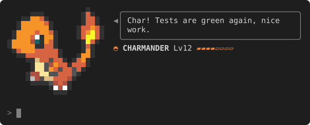
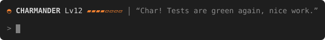
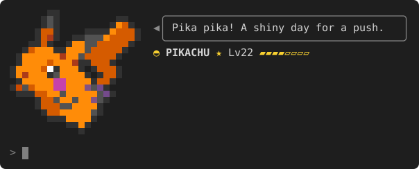
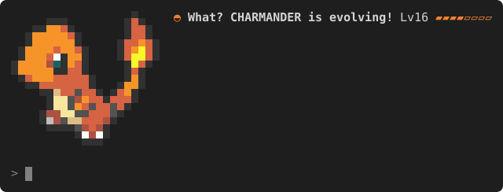

# pokebuddy



A Gen 1 Pokémon lives above your Claude Code prompt, reacts to each turn in a little speech bubble and grows from the work you do. You get one per Claude Code config folder, rolled at random the first time it runs, starting at level 5.

## Install

```
/plugin install pokebuddy --marketplace yonatankarp/pokebuddy
```

It is active at once. Ignore any "2 userConfig options not yet set" note: both settings have defaults. Needs Claude Code 2.1.296 or newer.

## Quick start

1. `/buddy` shows your Pokémon and its progress.
2. `/buddy feed` gives it a Rare Candy, once a day.
3. `/buddy toggle` switches between the full view and a one-line compact view.



## Commands

In some places Claude Code shows the command as `/pokebuddy:buddy`.

| Command | What it does |
| --- | --- |
| `/buddy` or `/buddy stats` | Your Pokémon, EXP and progress |
| `/buddy dex [name or number]` | A Pokédex entry, yours by default |
| `/buddy feed` | A Rare Candy, once a day (not in `-p` or SDK runs) |
| `/buddy use <stone>` | Evolve with a stone from your bag |
| `/buddy stop` | Cancel an evolution in progress |
| `/buddy toggle` | Full view or compact line |
| `/buddy quiet` | Speech and the session judge on or off |
| `/buddy nickname <name>` | Set a nickname of up to 12 characters, or clear it with no name |
| `/buddy export` | Copy your save to the clipboard |
| `/buddy import <blob>` | Load a save you exported |
| `/buddy restore` | Swap the backup slot back in |
| `/buddy reset [confirm]` | Explain a reset, or roll a new Pokémon once a day with `confirm` |

## How it grows

Your Pokémon earns EXP from prompts, tool use, commits, pushes and PRs, fixing failing checks, a daily Rare Candy and a score for each finished session. It levels at its Gen 1 growth rate and evolves by level, by stone or by trade, just like the original games. One in 512 is shiny, with its alternate colours and a ★ by its name.

<p> </p>

<details><summary>EXP table</summary>

| You | EXP | Limit |
| --- | --- | --- |
| Send a prompt (not a slash command) | 10 | none |
| Claude uses a tool | 2 | 40 per turn |
| Stay active | 5 per 10 minutes | only while you are sending prompts |
| Edit a config file | 25 | once per file, 3 files per turn |
| Commit | 30 | 3 per turn |
| Push or open a PR | 50 | 2 per turn |
| Fix a failing check (it fails, then passes) | 40 | 3 per turn |
| Finish a session (judged by the model) | 0 to 100 | once per session |
| `/buddy feed` | enough for the next level, more on a streak | once a day |

Config files are `CLAUDE.md`, `CLAUDE.local.md` and `AGENTS.md` anywhere, plus `settings*.json`, `CLAUDE.md`, `keybindings.json` and files under `agents/`, `commands/`, `skills/`, `hooks/` and `output-styles/` inside a `.claude/` folder. Empty commits and pushes with nothing to send earn nothing.

A check is a test, build, lint or type check run such as `npm test`, `./gradlew build`, `pytest` or `go vet ./...`. Runs without a person at the prompt (`claude -p`, the Agent SDK) earn nothing.

A session is scored when you start your next one, after it has ended. A session that crashed is scored once its last turn is a day old.

</details>

<details><summary>Stones and special evolutions</summary>

When a level evolution starts you have about 10 seconds to type `/buddy stop`; the next level-up tries again. Stones collect in your bag as you reach milestones, and every milestone repeats.

| Stone | Earned by |
| --- | --- |
| Thunder Stone | every 10 fixed checks |
| Fire Stone | every 10 commits |
| Water Stone | every 10 config edits |
| Leaf Stone | each 7-day feeding streak |
| Moon Stone | a turn before 5 am (once a night) |

A stone evolution only happens when you use the stone, so Eevee becomes whichever form you pick. Kadabra, Machoke, Graveler and Haunter evolve by trade: push or open a PR at level 36 or higher.

</details>

## Settings and privacy

Change them in `/config` (each option is a row there) or under `pluginConfigs.pokebuddy` in settings.json.

| Setting | Default | What it does |
| --- | --- | --- |
| `speechModel` | `haiku` | The model for speech and the session judge |
| `speechContext` | `conversation` | `conversation` lets speech react to what you asked and what Claude answered; `facts` sends only a summary |

At most one small model call per turn, plus one at session start to score earlier sessions; prompts and answers are never saved. `/buddy quiet` stops all calls.

<details><summary>What is sent and what is saved</summary>

In an interactive session with speech on, your buddy makes at most one model call per completed turn, and at most one more when a session starts, only if earlier sessions are waiting to be scored. Every call carries your buddy's name, species, level, nature and whether it is shiny, plus a short summary of the turn: counts of prompts, tool calls, commits, pushes and PRs, the check commands you ran with whether they passed (the runner and up to two plain words, like `npm test`, never flags, paths or values), and the names of config files you edited (never their paths).

With `conversation`, the turn's call also includes the first 300 characters of the turn's first prompt and of Claude's answer. With `facts`, that is all it sends. Scoring a session always gets the summaries alone.

Your save keeps the summary lines of sessions not yet scored, and the check names it uses to spot a fix; both are part of `/buddy export`. Prompt and answer text are never saved.

</details>

## Your save

It lives in your Claude Code config folder; `/buddy export` and `/buddy import` move it, and one backup slot keeps the save they or a reset replace.

<details><summary>Backup, recovery and uninstall</summary>

`/buddy restore` swaps the backup slot back in; a damaged save never overwrites a good backup. A reset needs `/buddy reset confirm` and works once a day.

If your save cannot be read, your buddy says so and tells you what can help: `/buddy restore` when the backup slot is good, otherwise `/buddy reset confirm` or `/buddy import`. A save from a newer version is left alone until you update the plugin.

An export is a convenience, not a signature: the checksum only catches damage from copying, so import only blobs you trust.

To uninstall, run `/plugin uninstall pokebuddy`, after an export if you might come back.

</details>

## Disclaimer and credits

Pokémon names, sprites and Pokédex text are trademarks and copyrights of Nintendo, Game Freak and The Pokémon Company and are not covered by this project's licence. This is an unofficial fan project. Pokédex data and sprites come from [PokeAPI](https://pokeapi.co) and the PokeAPI sprites repository.

Want to help build it? See [CONTRIBUTING.md](CONTRIBUTING.md).
