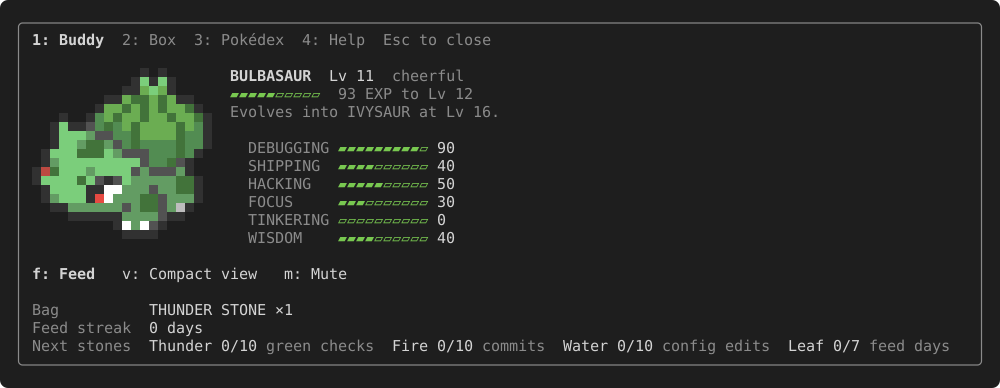
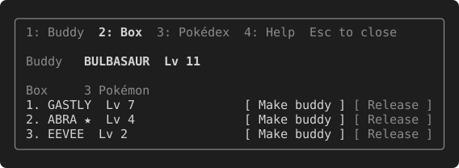
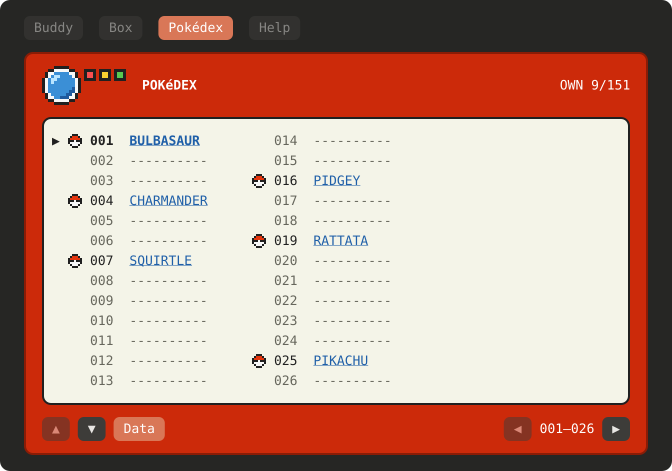
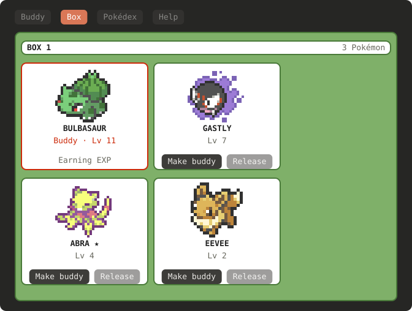

# pokebuddy

[](https://github.com/yonatankarp/pokebuddy/releases/latest)
[](https://github.com/yonatankarp/pokebuddy/actions/workflows/ci.yml)
[](LICENSE)
[](https://code.claude.com/docs/en/discover-plugins)


A Claude Code plugin with a Gen 1 Pokémon that lives above your prompt, reacts to each turn in a little speech bubble and grows from the work you do. You get one per Claude Code config folder, rolled at random the first time it runs, starting at level 1.

## Install

```
/plugin marketplace add yonatankarp/pokebuddy
/plugin install pokebuddy@pokebuddy
```

It is active at once. Ignore any "2 userConfig options not yet set" note: both settings have defaults. Needs Claude Code 2.1.296 or newer.

To update, run `claude plugin update pokebuddy@pokebuddy` and restart Claude Code. Don't uninstall and reinstall to update: uninstalling deletes your save.

## Quick start

1. `/buddy` opens the panel: your Pokémon, its skills, your box, the Pokédex and the command list. In the terminal the number keys switch tabs, the letter shown before a button presses it, and Esc closes it.
2. Feed it a Rare Candy once a day, from the panel or with `/buddy feed`.
3. Work as usual: wild Pokémon turn up as you fix checks and commit, and you can switch your buddy to any of them.



<p> </p>

In the desktop app and VS Code your Pokémon idles, breathing, twitching and looking round, with its Pokémon Mystery Dungeon idle animation. The Buddy tab is a Game Boy summary screen, the Pokédex is the red device, with its lens, lights and screen, and the box is a PC box with a card for each Pokémon:



<p> </p>



## Commands

In some places Claude Code shows the command as `/pokebuddy:buddy`.

| Command | What it does |
| --- | --- |
| `/buddy` | Open the panel (as text in `-p` runs) |
| `/buddy stats` | Your Pokémon, EXP, progress and skills as text |
| `/buddy box` | Your buddy and the Pokémon in your box |
| `/buddy switch <number or name>` | Make a Pokémon from the box your buddy |
| `/buddy release <number> confirm` | Let a Pokémon from the box go |
| `/buddy dex [name or number]` | A Pokédex entry, yours by default |
| `/buddy feed` | A Rare Candy, once a day (not in `-p` or SDK runs) |
| `/buddy use <stone>` | Evolve with a stone from your bag |
| `/buddy stop` | Cancel an evolution in progress |
| `/buddy toggle` | Full view or compact line |
| `/buddy quiet` | Speech and the session judge on or off |
| `/buddy nickname <name>` | Set a nickname of up to 12 characters, or clear it with no name |

## How it grows

Your Pokémon earns EXP from prompts, tool use, commits, pushes and PRs, fixing failing checks, a daily Rare Candy and a score for each finished session. It levels at its Gen 1 growth rate and evolves by level, by stone or by trade, just like the original games. One in 512 is shiny, with its alternate colours and a ★ by its name.

Six skills show what kind of work it grew from, each 0 to 99: DEBUGGING (fixed checks), SHIPPING (commits, pushes and PRs), HACKING (tool use), FOCUS (prompts and active time), TINKERING (config edits) and WISDOM (session scores). Each is the square root of the EXP behind it, so your first sessions show up and the top takes real work. `/buddy stats` lists them, and the full view draws them as bars beside the bubble: always in the Claude desktop app and the editor, and in the terminal when it is wide enough (about 100 columns).

<p> </p>

<details><summary>EXP table</summary>

| You | EXP | Limit |
| --- | --- | --- |
| Send a prompt (not a slash command) | 10 | none |
| Claude uses a tool | 2 | 40 per turn |
| Stay active | 5 per 10 minutes | only while you are sending prompts |
| Edit a config file | 25 | once per file, 3 files per turn |
| Commit | 30 | 3 per turn |
| Push or open a PR | 50 | 2 per turn |
| Fix a failing check (it fails, then passes) | 40 | 3 per turn |
| Finish a session (judged by the model) | 0 to 100 | once per session |
| `/buddy feed` | enough for the next level, more on a streak | once a day |

Config files are `CLAUDE.md`, `CLAUDE.local.md` and `AGENTS.md` anywhere, plus `settings*.json`, `CLAUDE.md`, `keybindings.json` and files under `agents/`, `commands/`, `skills/`, `hooks/` and `output-styles/` inside a `.claude/` folder. Empty commits and pushes with nothing to send earn nothing.

A check is a test, build, lint or type check run such as `npm test`, `./gradlew build`, `pytest` or `go vet ./...`. Runs without a person at the prompt (`claude -p`, the Agent SDK) earn nothing.

A session is scored when you start your next one, after it has ended. A session that crashed is scored once its last turn is a day old.

</details>

<details><summary>Stones and special evolutions</summary>

When a level evolution starts you have about 10 seconds to type `/buddy stop`; the next level-up tries again. Stones collect in your bag as you reach milestones, and every milestone repeats.

| Stone | Earned by |
| --- | --- |
| Thunder Stone | every 10 fixed checks |
| Fire Stone | every 10 commits |
| Water Stone | every 10 config edits |
| Leaf Stone | each 7-day feeding streak |
| Moon Stone | a turn before 5 am (once a night) |

A stone evolution only happens when you use the stone, so Eevee becomes whichever form you pick. Kadabra, Machoke, Graveler and Haunter evolve by trade: push or open a PR at level 36 or higher.

</details>

## Catching more

Wild Pokémon turn up at random while you work and are caught at once. Each fixed check has a 1 in 5 chance of bringing one, each commit 1 in 10, any turn where Claude uses tools 3 in 100, and a session judged 80 or more an even chance. Every 7th day of a feed streak always brings one, with a better shiny chance. At most 3 a day. They join your box at level 1, and `/buddy switch` or the panel's Box tab makes any of them your buddy. Only your buddy earns EXP, so you choose who to train; skills, stones and the feed streak are yours and carry over. The Pokédex tab lists all 151 the way the Game Boy one does, with ◓ on the ones you have caught, and opens the entry of any of those.

## Settings and privacy

Change them in `/config` (each option is a row there) or under `pluginConfigs.pokebuddy` in settings.json.

| Setting | Default | What it does |
| --- | --- | --- |
| `speechModel` | `haiku` | The model for speech and the session judge |
| `speechContext` | `conversation` | `conversation` lets speech react to what you asked and what Claude answered; `facts` sends only a summary |

At most one small model call per turn, plus one at session start to score earlier sessions; prompts and answers are never saved. `/buddy quiet` stops all calls.

<details><summary>What is sent and what is saved</summary>

In an interactive session with speech on, your buddy makes at most one model call per completed turn, and at most one more when a session starts, only if earlier sessions are waiting to be scored. Every call carries your buddy's name, species, level, nature and whether it is shiny, plus a short summary of the turn: counts of prompts, tool calls, commits, pushes and PRs, the check commands you ran with whether they passed (the runner and up to two plain words, like `npm test`, never flags, paths or values), and the names of config files you edited (never their paths).

With `conversation`, the turn's call also includes the first 300 characters of the turn's first prompt and of Claude's answer. With `facts`, that is all it sends. Scoring a session always gets the summaries alone.

Your save keeps the summary lines of sessions not yet scored, and the check names it uses to spot a fix. Prompt and answer text are never saved.

</details>

<details><summary>What each hook does</summary>

The plugin only watches: every hook passes its event on unchanged, and none blocks, rewrites or answers a prompt, a tool call or a permission check. It has no permission-check hook.

| Hook | What it does |
| --- | --- |
| `session.start` | Registers `/buddy`, finishes an evolution a restart interrupted, and scores sessions that have ended |
| `session.attach` | Marks the session as watched when the desktop app or the editor attaches, and scores ended sessions if that has not run yet |
| `session.end` | Marks this session's lines for scoring at the next start |
| `prompt.submit` | Counts the prompt for EXP (not slash commands) and redraws a save another session wrote |
| `tool.call` | Reads the finished call (the tool, its command or file path, whether it failed, and its output) to spot commits, pushes, PRs, config edits and checks; only short check names and config file names reach the save |
| `turn.complete` | Adds up the turn's EXP, logs a one-line summary and asks the speech model for a reaction |
| `command.run` | Answers `/buddy`, and opens the panel for a bare `/buddy` |
| `ui.render` | Draws the band above the prompt and the `/buddy` panel; the panel's buttons run `/buddy` commands |

</details>

## Your save

It lives in your Claude Code config folder, in `plugins/store/`. Updating the plugin keeps it.

If your save cannot be read, it is kept aside under its own name in the same file and a new Pokémon appears in its place. A save from a newer version is left alone until you update the plugin.

Uninstalling with `/plugin uninstall pokebuddy` deletes your save, and there is no way to bring it back.

## Disclaimer and credits

Pokémon names, sprites and Pokédex text are trademarks and copyrights of Nintendo, Game Freak and The Pokémon Company and are not covered by this project's licence. This is an unofficial fan project. Pokédex data and sprites come from [PokeAPI](https://pokeapi.co) and the PokeAPI sprites repository. The idle animations are Pokémon Mystery Dungeon sprites from [PMDCollab SpriteCollab](https://github.com/PMDCollab/SpriteCollab), shared under [CC BY-NC 4.0](https://creativecommons.org/licenses/by-nc/4.0/); their artists are listed in [plugin/SPRITE-CREDITS.md](plugin/SPRITE-CREDITS.md).

Want to help build it? See [CONTRIBUTING.md](CONTRIBUTING.md).
